# SOC Home Lab: Splunk SIEM, Sysmon & Atomic Red Team

A self-hosted, isolated Security Operations Center (SOC) home lab built on VMware Workstation to practice log ingestion, endpoint telemetry, attack simulation (MITRE ATT&CK), and detection engineering using Splunk SPL.

---

## 1. Lab Architecture & Design
To optimize host resources (16 GB RAM total), Phase 1 consolidates the SIEM and endpoint telemetry on a single Windows Server 2022 VM (`SOC-LAB-01`), while the Windows 11 host acts as the SOC Analyst workstation accessing Splunk Web remotely.

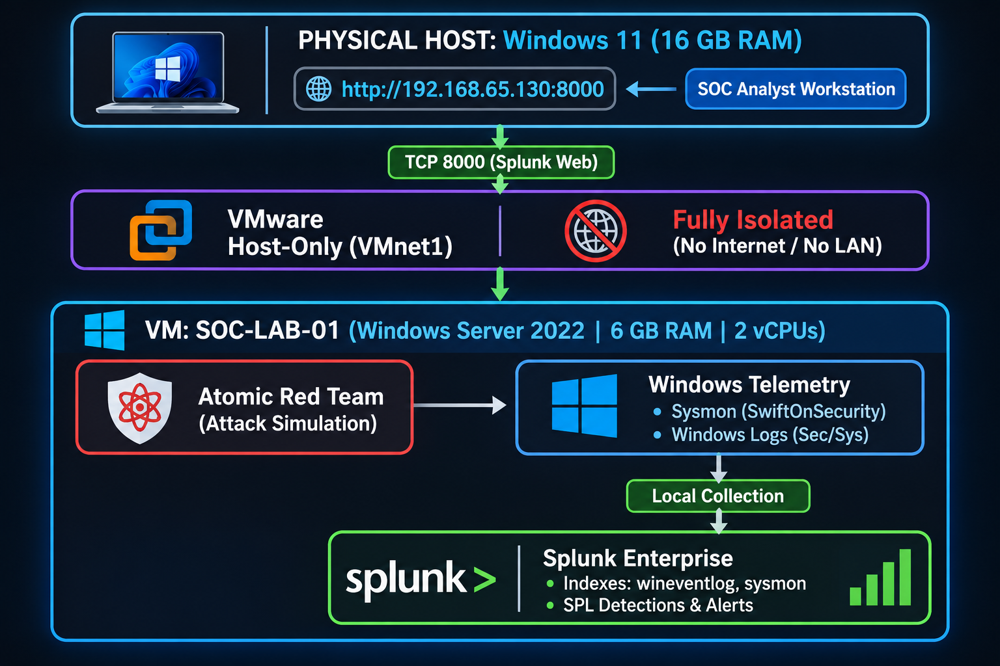

---

## 2. Step 1: VM Provisioning & Windows Server 2022 Setup
* **Hypervisor:** VMware Workstation
* **VM Name:** `SOC-LAB-01`
* **Resources:** 6144 MB RAM, 2 vCPUs, 100 GB Dynamically Allocated Disk, UEFI Firmware.
* **OS Edition:** Selected **Windows Server 2022 Standard Evaluation (Desktop Experience)** rather than Server Core to allow GUI-based troubleshooting, local browser verification, and easier management during initial lab setup.
* **Configuration:** Left as a Standalone Workgroup (no Active Directory or extra Server Roles installed in Phase 1).
* **Initial Network:** Set to **NAT (`VMnet8`)** temporarily to download tools and configurations.

<!-- Screenshot 1: VMware VM Settings showing RAM, CPU, Disk, and OS -->
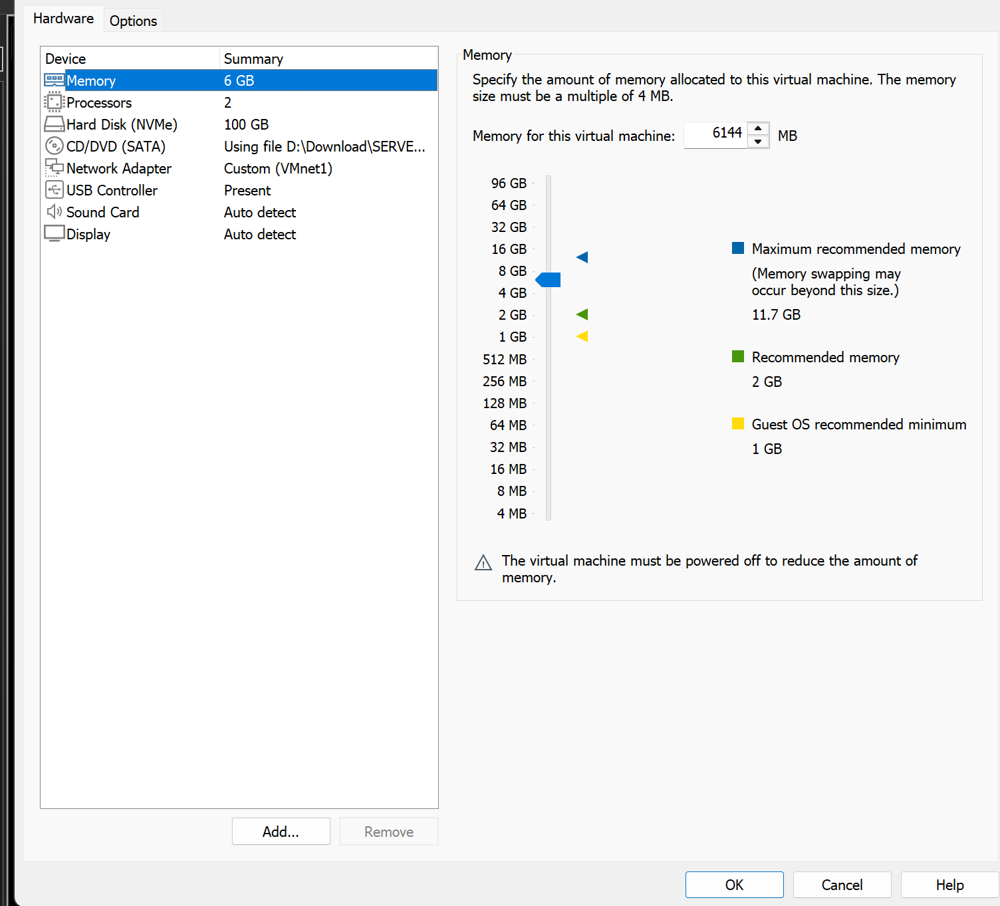

---

## 3. Step 2: Splunk Enterprise Installation & Index Configuration
Installed **Splunk Enterprise (Windows 64-bit)** in `C:\Program Files\Splunk` running as `Local System` with Web Port `8000` and Management Port `8089`.

### Issue Encountered: Blank "Manage Indexes" Page
* **Problem:** Accessing `http://localhost:8000/en-US/manager/launcher/data/indexes` inside Windows Server rendered a blank white page below the top navigation bar because the legacy Microsoft Edge version bundled with Windows Server 2022 failed to render Splunk's modern JavaScript UI.
* **Solution:** Allowed inbound `TCP 8000` through Windows Defender Firewall and accessed Splunk Web directly from the updated browser on the Windows 11 host.

```cmd
:: Check VM IP address
ipconfig

:: Allow Splunk Web port 8000 in Windows Firewall
netsh advfirewall firewall add rule name="Splunk Web" dir=in action=allow protocol=TCP localport=8000
```

<!-- Screenshot 2: Splunk Manage Indexes showing wineventlog and sysmon enabled -->
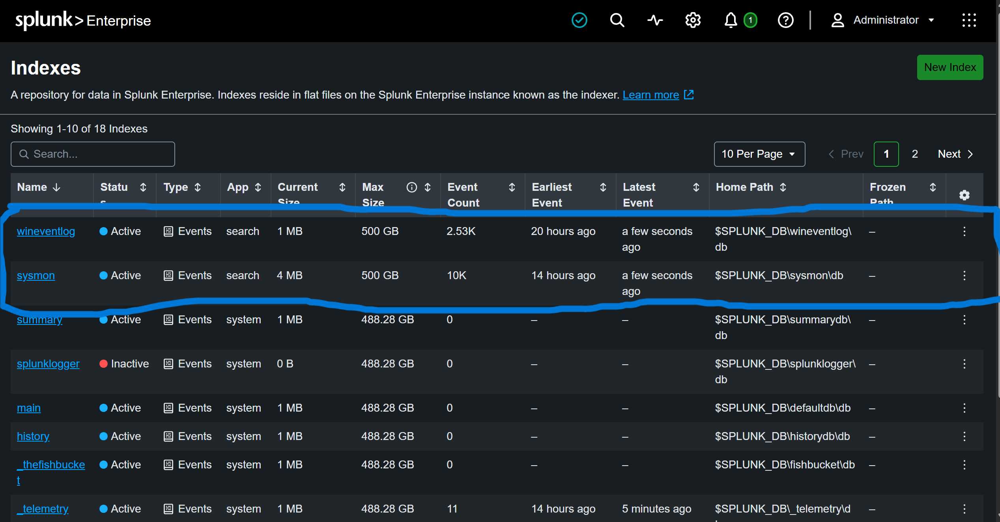

### Data Collection Setup
1. Created two dedicated indexes under **Settings → Indexes**:
   * `wineventlog` (for native Windows Security & System logs)
   * `sysmon` (for Sysmon operational telemetry)
2. Enabled **Local Event Log Collection** (**Settings → Data inputs**) for `Security` and `System` logs, routed to `index=wineventlog`.
3. Verified ingestion in **Search & Reporting** using `index=wineventlog`.

---

## 4. Step 3: Sysmon Deployment & Splunk Integration
Deployed **Microsoft Sysmon** with the **SwiftOnSecurity** configuration to capture high-fidelity endpoint telemetry (process creation, command lines, network connections, and registry modifications).

### Issue Encountered: PowerShell Cmdlets in CMD
* **Problem:** Running `Invoke-WebRequest` directly in Command Prompt returned `'Invoke-WebRequest' is not recognized`.
* **Solution:** Switched the terminal session to PowerShell (`powershell`) before executing download and archive commands.

### Commands Executed
```powershell
# Switch to PowerShell and create directory
mkdir C:\Sysmon
cd C:\Sysmon

# Download Sysmon and SwiftOnSecurity configuration
Invoke-WebRequest -Uri "[https://download.sysinternals.com/files/Sysmon.zip](https://download.sysinternals.com/files/Sysmon.zip)" -OutFile "Sysmon.zip"
Expand-Archive -Path "Sysmon.zip" -DestinationPath "C:\Sysmon" -Force
Invoke-WebRequest -Uri "[https://raw.githubusercontent.com/SwiftOnSecurity/sysmon-config/master/sysmonconfig-export.xml](https://raw.githubusercontent.com/SwiftOnSecurity/sysmon-config/master/sysmonconfig-export.xml)" -OutFile "sysmonconfig-export.xml"

# Install Sysmon with the config file
.\Sysmon64.exe -accepteula -i sysmonconfig-export.xml
```

<!-- Screenshot 3: PowerShell output showing Sysmon64 installed and started -->
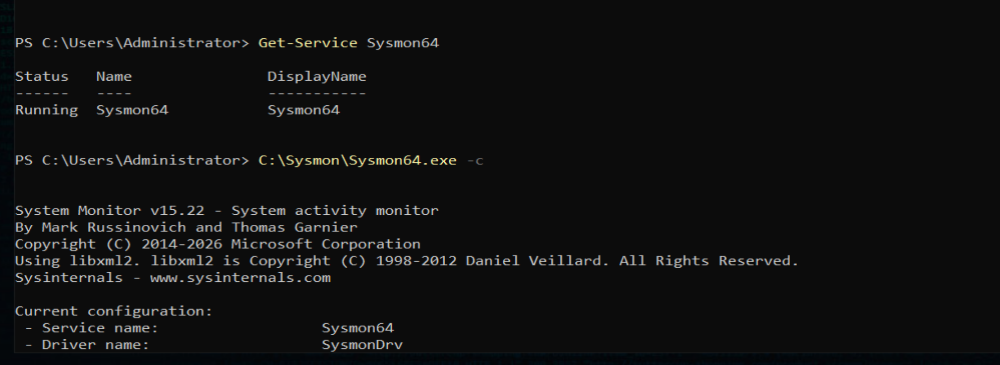

### Configuring Splunk to Ingest Sysmon Logs
Appended the Sysmon operational log stanza to `inputs.conf` with XML rendering enabled for clean field extraction:

```powershell
Add-Content -Path "C:\Program Files\Splunk\etc\system\local\inputs.conf" -Value "`n[WinEventLog://Microsoft-Windows-Sysmon/Operational]`ndisabled = false`nindex = sysmon`nrenderXml = true"
```

### Issue Encountered: `Splunkd` Service Restart Failure
* **Problem:** Running `Restart-Service Splunkd` in PowerShell failed with `Cannot stop Splunkd service on computer '.'`.
* **Solution:** Restarted Splunk cleanly using its native CLI executable:

```powershell
& "C:\Program Files\Splunk\bin\splunk.exe" restart
```

Verified log ingestion in Splunk using `index=sysmon` (500+ events received immediately).

<!-- Screenshot 4: Splunk Search & Reporting showing Sysmon events arriving in index=sysmon -->
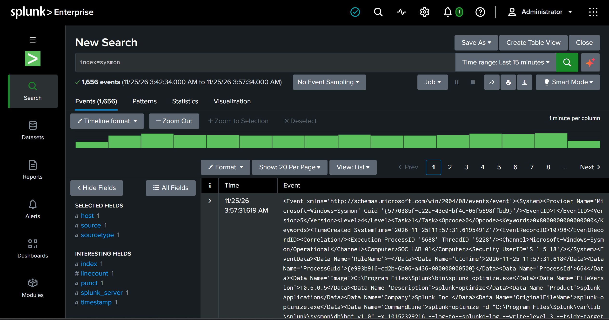

---

## 5. Step 4: Atomic Red Team Installation
Installed **Invoke-AtomicRedTeam** and the Atomics library to simulate MITRE ATT&CK techniques safely inside the lab.

### Issue Encountered: Windows Defender / AMSI Block
* **Problem:** Running `IEX (IWR ...)` triggered `ScriptContainedMaliciousContent` as Windows Defender blocked the in-memory installation script before it reached the excluded directory.
* **Solution:** Added a folder exclusion for `C:\AtomicRedTeam`, temporarily disabled Real-Time Monitoring inside the isolated lab VM during installation, and verified the framework.

```powershell
# Exclude Atomic Red Team directory and temporarily disable Real-Time Monitoring for installation
Add-MpPreference -ExclusionPath "C:\AtomicRedTeam"
Set-MpPreference -DisableRealtimeMonitoring $true

# Install Invoke-AtomicRedTeam and Atomics library
Set-ExecutionPolicy Bypass -Scope Process -Force
[Net.ServicePointManager]::SecurityProtocol = [Net.SecurityProtocolType]::Tls12
IEX (IWR '[https://raw.githubusercontent.com/redcanaryco/invoke-atomicredteam/master/install-atomicredteam.ps1](https://raw.githubusercontent.com/redcanaryco/invoke-atomicredteam/master/install-atomicredteam.ps1)' -UseBasicParsing)
Install-AtomicRedTeam -getAtomics -Force

# Verify installation by listing tests for T1059.001 (PowerShell)
Invoke-AtomicTest T1059.001 -ShowDetailsBrief
```

<!-- Screenshot 5: PowerShell output listing Atomic Red Team tests for T1059.001 -->
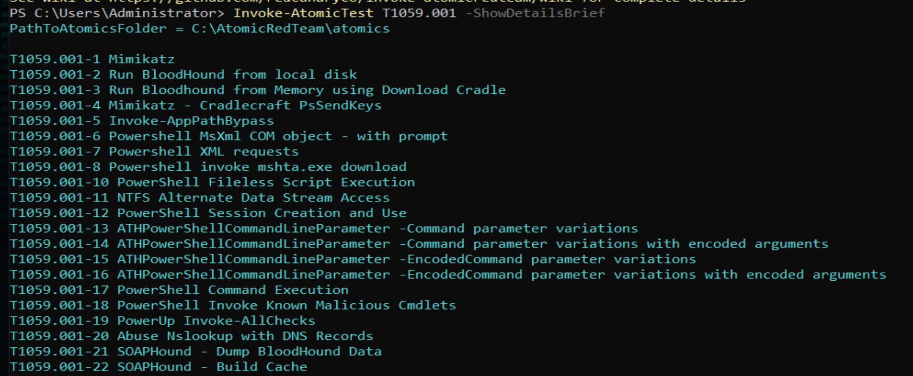

---

## 6. Step 5: Network Isolation (Host-Only) & Troubleshooting
Before running any attack simulations, the VM was isolated from the internet and home network by switching its VMware Network Adapter from **NAT** to **Host-Only (`VMnet1`)**.

### Issue Encountered: Connection Timeout on Host-Only Network
* **Problem:** After switching to `Host-Only`, the VM received IP `192.168.65.130` (with no Default Gateway), but accessing `http://192.168.65.130:8000` from Windows 11 timed out.
* **Root Cause:**
  1. The firewall rule needed to apply across all network profiles (`Public`/`Private`/`Domain`) since Host-Only is classified as an Unidentified/Public network.
  2. Running `ipconfig` on the Windows 11 host revealed that `VMware Network Adapter VMnet1` had a mismatched static IP (`192.168.10.2/24` with gateway `192.168.10.1`) on a different subnet than the VM (`192.168.65.x`).
* **Solution:**
  1. Updated the Windows Server firewall rule to apply to all profiles:
     ```powershell
     netsh advfirewall firewall set rule name="Splunk Web" new profile=any
     ```
  2. Reconfigured `VMnet1` IPv4 settings on Windows 11 (`ncpa.cpl`) to match the VM subnet:
     * **IP Address:** `192.168.65.1`
     * **Subnet Mask:** `255.255.255.0`
     * **Default Gateway:** *(Left empty)*
  3. Verified full Splunk Web connectivity at `http://192.168.65.130:8000` while maintaining complete network isolation.
  4. Took a clean VMware Snapshot (`Clean-Lab-Ready`) as a safe rollback point before attack execution.

<!-- Screenshot 6: VM ipconfig showing Host-Only IP with empty Default Gateway -->
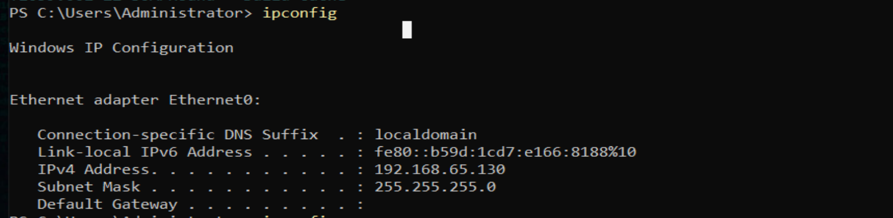

---

---

## 7. Phase 2: Attack Simulations & Detection Engineering

### Detection 1: System Information Discovery (`T1082`)
* **MITRE ATT&CK Tactic:** Discovery (`T1082`)
* **Data Source:** Sysmon (`Event ID 1` - Process Creation)
* **Simulation Command:**
  ```powershell
  Invoke-AtomicTest T1082 -TestNumbers 1
  ```
* **Splunk SPL Query:** [View Query](detections/T1082_system_info.spl)
* **Analyst Findings (Process Tree):**
  * The query returned **2 events**, revealing the full execution chain: `powershell.exe` → `cmd.exe` → `systeminfo.exe`.
  * Identifying `powershell.exe` spawning `cmd.exe` to run reconnaissance commands is a strong indicator of scripted/automated discovery rather than normal administrative usage.
* **Troubleshooting Note (XML Parsing):**
  * Initial queries using `EventCode=1` returned no results because `renderXml = true` ingested raw XML without the Sysmon TA installed.
  * Resolved temporarily using SPL `rex` field extraction, and permanently by switching `renderXml = false` in `inputs.conf`.

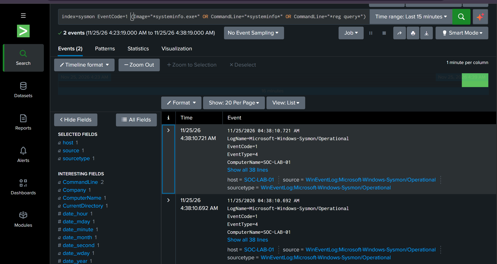

### Detection 2: Encoded & Hidden PowerShell Execution (`T1059.001`)
* **MITRE ATT&CK Tactic:** Execution (`T1059.001`)
* **Data Source:** Sysmon (`Event ID 1` - Process Creation)
* **Alert Severity:** High
* **Simulation Command (Offline Base64 Execution):**
  ```powershell
  $cmd = "whoami; hostname; Get-Date"
  $encoded = [Convert]::ToBase64String([Text.Encoding]::Unicode.GetBytes($cmd))
  powershell.exe -NoProfile -WindowStyle Hidden -EncodedCommand $encoded
  ```
* **Splunk SPL Query:** [View Query](detections/T1059_001_encoded_powershell.spl)
* **Analyst Triage & Findings:**
  * Detected `powershell.exe` launching with suspicious evasion flags (`-NoProfile`, `-WindowStyle Hidden`, `-EncodedCommand`).
  * Extracted the Base64 payload from the `CommandLine` field and decoded it (UTF-16LE) to reveal the underlying reconnaissance commands (`whoami; hostname; Get-Date`).

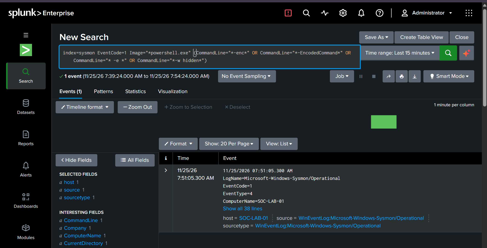
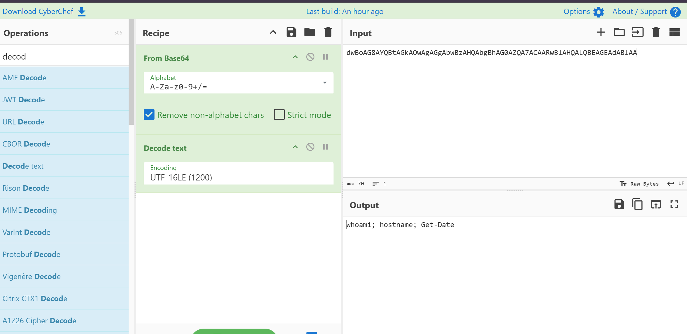

### Detection 3: Scheduled Task Persistence (`T1053.005`)
* **MITRE ATT&CK Tactic:** Persistence (`T1053.005`)
* **Data Source:** Sysmon (`Event ID 1` - Process Creation)
* **Alert Severity:** High
* **Simulation & Cleanup Commands:**
  ```powershell
  Invoke-AtomicTest T1053.005 -TestNumbers 1
  Invoke-AtomicTest T1053.005 -TestNumbers 1 -Cleanup
  ```

  ---
* **Splunk SPL Query:** [View Query](detections/T1053_005_scheduled_task.spl)
* **Analyst Triage & Findings:**
  * Detected `cmd.exe` spawning `schtasks.exe /create` to establish two persistence mechanisms: one triggered on user logon (`/sc onlogon`) and a high-privilege task running as `SYSTEM` on startup (`/sc onstart /ru system`).

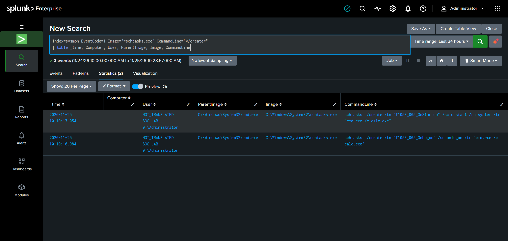

## 8. SOC Monitoring Dashboard
To centralize visibility across the lab, I built a Splunk Dashboard that tracks Sysmon ingestion health, Event ID distribution, process creation timelines, and a unified **MITRE ATT&CK Detection Table** mapping all simulated techniques dynamically using SPL `eval/case`.

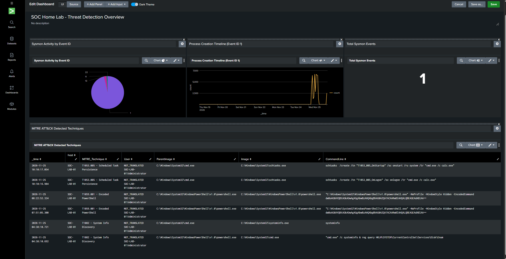


### Detection 4: SAM & SYSTEM Registry Credential Dumping (`T1003.002`)
* **MITRE ATT&CK Tactic:** Credential Access (`T1003.002`)
* **Data Source:** Sysmon (`Event ID 1` - Process Creation)
* **Alert Severity:** Critical
* **Attack Overview & Real-World Scenario:**
  * Windows stores local user password hashes in the **SAM** registry hive and the boot key required to decrypt them in the **SYSTEM** hive. Because these files are locked while the OS is running, attackers with administrative privileges abuse the native `reg.exe` utility (`Living off the Land`) to dump `HKLM\SAM`, `HKLM\SYSTEM`, and `HKLM\SECURITY` into temporary files.
  * In real-world intrusions, these hives are exfiltrated to extract NTLM hashes offline (e.g., via `secretsdump.py`) for password cracking or **Pass-the-Hash** lateral movement.
* **Simulation & Cleanup Commands:**
  ```powershell
  Invoke-AtomicTest T1003.002 -TestNumbers 1
  Invoke-AtomicTest T1003.002 -TestNumbers 1 -Cleanup
  ```
* **Splunk SPL Query:** [View Query](detections/T1003_002_sam_dump.spl)
* **Analyst Triage & Real-World Threat Hunting:**
  * **Process Analysis:** Verified `cmd.exe` spawning `reg.exe save` targeting sensitive registry hives (`sam`, `system`, `security`) and writing outputs to `%TEMP%`.
  * **Enterprise Hunting Tips:**
    * Hunt by `CommandLine` arguments (`save` + `sam`/`system`) regardless of binary name to catch renamed `reg.exe` binaries.
    * Correlate with **Sysmon Event ID 11 (FileCreate)** for `.save`/`.hiv` files in `%TEMP%` or `C:\Users\Public`, and **Event ID 3 (NetworkConnect)** to detect exfiltration.
    * Monitor alternative dumping methods such as `vssadmin create shadow` or `esentutl /y`.

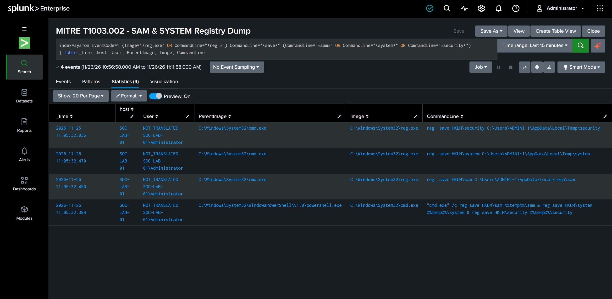

### Detection 5: Local Account Creation for Persistence (`T1136.001`)
* **MITRE ATT&CK Tactic:** Persistence (`T1136.001`)
* **Data Source:** Sysmon (`Event ID 1` - Process Creation)
* **Alert Severity:** High
* **Attack Overview & Real-World Scenario:**
  * Attackers often create unauthorized local user accounts and add them to the local `Administrators` or `Remote Desktop Users` groups to maintain stealthy, persistent access without relying on malware.
  * Using native Windows utilities (`net.exe`, `net1.exe`, or PowerShell `New-LocalUser`), adversaries can log back in legitimately via RDP or SMB, often naming the account something benign (e.g., `svc_backup`) to blend in.
* **Simulation & Cleanup Commands:**
  ```powershell
  # Simulation (via Atomic Red Team Windows test or direct net commands)
  net user backdoor_user P@ssw0rd123! /add
  net localgroup administrators backdoor_user /add

  # Cleanup
  net user backdoor_user /delete
  ```
* **Splunk SPL Query:** [View Query](detections/T1136_001_create_local_account.spl)
* **Analyst Triage & Real-World Threat Hunting:**
  * **Process Analysis:** Detected **4 Sysmon Event ID 1 entries**—two for account creation and two for local admin group assignment—because Windows automatically spawns `net1.exe` as a child process whenever `net.exe` executes. Including both binaries in the SPL rule prevents evasion if an attacker invokes `net1.exe` directly.
  * **Enterprise Hunting Tips:**
    * Correlate Sysmon `Event ID 1` with **Windows Security Event ID 4720** (User Account Created) and **Event ID 4732** (Member Added to Security-Enabled Local Group, especially `Administrators`).
    * Monitor PowerShell equivalents (`New-LocalUser`, `Add-LocalGroupMember`) via Script Block Logging (`Event ID 4104`).
    * Flag any local account creation on domain-joined workstations or member servers, as legitimate provisioning typically occurs centrally in Active Directory.

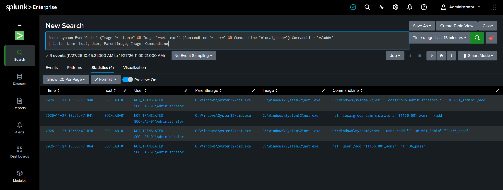

### Detection 6: Clearing Windows Event Logs (`T1070.001`)
* **MITRE ATT&CK Tactic:** Defense Evasion (`T1070.001`)
* **Data Source:** Sysmon (`Event ID 1` - Process Creation)
* **Alert Severity:** Critical
* **Attack Overview & Real-World Scenario:**
  * Adversaries clear Windows Event Logs using native utilities (`wevtutil.exe cl` or PowerShell `Clear-EventLog`) to destroy forensic evidence and hinder incident response.
  * Forwarding telemetry in real time to an external SIEM (Splunk) mitigates local tampering because historical events are already preserved off-host and the clearing command triggers a critical alert.
* **Simulation Command:**
  ```powershell
  wevtutil.exe cl Setup
  ```
* **Splunk SPL Query:** [View Query](detections/T1070_001_clear_event_logs.spl)
* **Analyst Triage & Real-World Threat Hunting:**
  * **Process Analysis:** Detected `wevtutil.exe` executing with the `cl` flag to wipe Windows event logs.
  * **Enterprise Hunting Tips:**
    * Monitor native Windows alerts: **Security Event ID 1102** (Audit log cleared) and **System Event ID 104** (Log file cleared).
    * Hunt for PowerShell equivalents (`Clear-EventLog`, `Remove-EventLog`) and service tampering (`sc stop`, `net stop` targeting Sysmon or SIEM forwarders).
    * Always pivot backward in SIEM logs prior to the log-clearing timestamp to uncover the preceding intrusion activity.

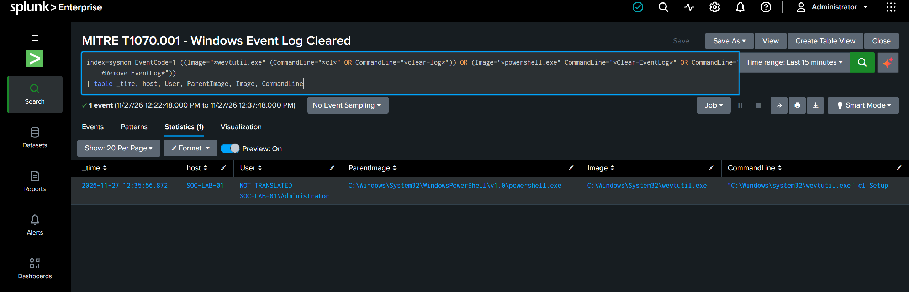
